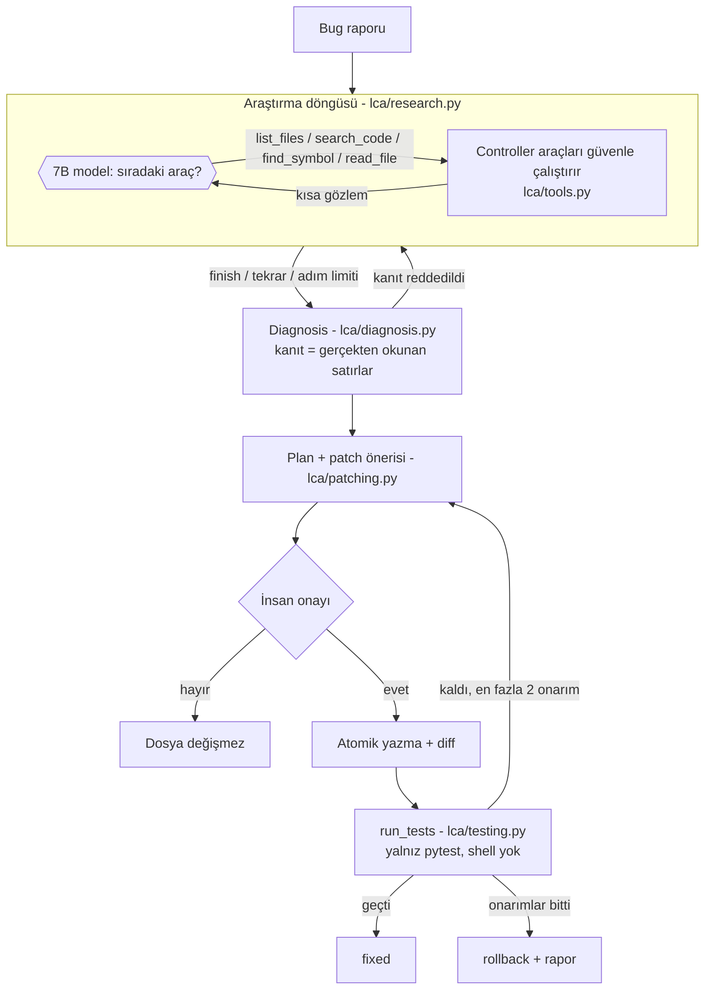

# Local Coding Agent

16 GB'lık bir M3 MacBook'ta Ollama ile çalışan küçük bir yerel modeli
(`qwen2.5-coder:7b`) araçlar, küçük context ve sıkı bir controller ile
**gerçek bug düzeltme** işinde kullanılabilir hale getiren stajyer projesi.

Agent bir bug raporunu alır, repository'yi araçlarla keşfeder (bütün repoyu
prompt'a yüklemez), kanıta dayalı bir diagnosis yazar, küçük bir patch önerir,
**senin onayınla** uygular, testleri çalıştırır ve gerekirse en fazla iki kez onarır.

> Ayrıntılı öğrenme rehberi: **[OGRENME_REHBERI.md](OGRENME_REHBERI.md)**
> (her dosyanın ne işe yaradığı, neden böyle yazıldığı, ölçümler ve hata analizi).
> Yol haritası ve ilerleme günlüğü: [YOL_HARITASI.md](YOL_HARITASI.md).
> Eski mimari: [legacy/](legacy/) ve `legacy-v1` dalı.

## Mimari



## Sonuçlar (özet)

15 issue, her biri temiz kopyada; testleri değerlendirici çalıştırır.

| model | retrieval | diagnosis | geçerli patch | otonom çözüm | ort. süre/issue |
| --- | --- | --- | --- | --- | --- |
| qwen2.5-coder:7b | 13/15 | 8/15 | 12/15 | **5/15** | 141 sn |
| qwen2.5-coder:3b | 9/15 | 4/15 | 7/15 | 1/15 | 46 sn |

Ayrıntı, context karşılaştırması ve başarısızlık analizi: [OGRENME_REHBERI.md §6–7](OGRENME_REHBERI.md).
Demo senaryosu: [DEMO.md](DEMO.md), sunum taslağı: [SUNUM.md](SUNUM.md).

## Kurulum

```bash
python3 -m venv venv
./venv/bin/python -m pip install -r requirements.txt
ollama pull qwen2.5-coder:7b
ollama pull qwen2.5-coder:3b
```

## Kullanım

```bash
# Sadece araştır + diagnosis (dosya değiştirmez)
./venv/bin/python -m lca --repo taskflow "Completed tasks still show up as overdue."

# Bug'lı bir kopya hazırla ve düzeltmeyi dene (patch'ten önce onay sorar)
./venv/bin/python eval/issues.py prepare easy_04
./venv/bin/python -m lca --repo eval/workspace/easy_04 --fix "Tasks that are already DONE still show up in the overdue list."

# 3B modelle dene
./venv/bin/python -m lca --model qwen2.5-coder:3b --repo eval/workspace/easy_04 "..."
```

`--yes` onayı atlar; yalnızca atılabilir kopyalarda kullan (değerlendirme bunu yapar).

## Testler ve değerlendirme

```bash
./venv/bin/python -m pytest                     # agent'ın birim testleri (model gerekmez)
./venv/bin/python -m pytest taskflow            # örnek repo testleri
./venv/bin/python eval/issues.py check          # her bug yalnız kendi testlerini kırıyor mu?
./venv/bin/python eval/run_eval.py              # 15 issue, varsayılan model (uzun sürer)
./venv/bin/python eval/run_eval.py --difficulty easy --model qwen2.5-coder:3b
```

Sonuç tabloları `eval/results/*.md` altında.

## Klasörler

| Klasör | İçerik |
| --- | --- |
| `lca/` | Agent: araçlar, döngü, diagnosis, patch, test, CLI |
| `tests/` | Agent'ın birim testleri (sahte model ile, deterministik) |
| `taskflow/` | Agent'ın üzerinde çalıştığı örnek backend (temiz, bug'sız hali) |
| `eval/issues/` | 15 issue: metin, enjekte edilecek bug, ground truth |
| `eval/results/` | Ölçüm sonuçları (JSON + Markdown tablo) |
| `legacy/` | Eski 8 aşamalı mimari; yalnızca referans |
